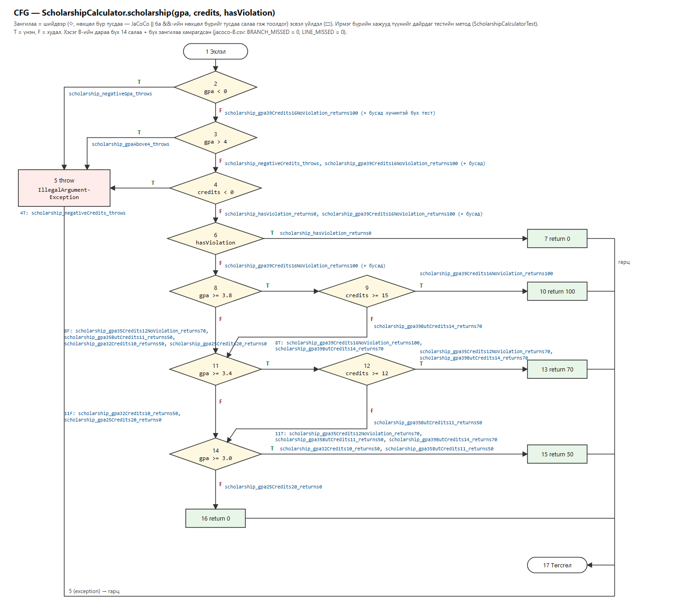

# Лаборатори №9 — Код хамралт: JaCoCo-гоор тестээ хөтлөх

**Оюутан:**  Я. Төгөлдөр
**Оюутны код:** B242270806
**Хичээл:** F.CSA313 — Программ хангамжийн чанарын баталгаа ба тест (2026)

---

## 1. Ажлын орчин

```
$ java -version
openjdk version "17.0.20.1" 2026-08-18
OpenJDK Runtime Environment Temurin-17.0.20.1+1 (build 17.0.20.1+1)
OpenJDK 64-Bit Server VM Temurin-17.0.20.1+1 (build 17.0.20.1+1, mixed mode, sharing)

$ mvn -version
Apache Maven 3.9.9 (8e8579a9e76f7d015ee5ec7bfcdc97d260186937)
Maven home: C:\Users\THE_FEDzUP\tools\apache-maven-3.9.9
Java version: 17.0.20.1, vendor: Eclipse Adoptium, runtime: C:\Program Files\Eclipse Adoptium\jdk-17.0.20.101-hotspot
Default locale: en_US, platform encoding: Cp1252
OS name: "windows 11", version: "10.0", arch: "amd64", family: "windows"
```

| Зүйл | Утга |
|---|---|
| JDK | Eclipse Temurin OpenJDK 17.0.20.1 |
| Build | Apache Maven 3.9.9 |
| Тест / хамралт | JUnit Jupiter 5.10.2, surefire 3.2.5, JaCoCo 0.8.12 |
| ҮС | Windows 11 Pro (26200), Git Bash (`tee` нь UTF-8 бичдэг тул results/ файлуудыг Git Bash-аар хадгалсан) |

> Starter төслийг (Teams → Class Materials → Labs → Lab09: `pom.xml`, `ScholarshipCalculator.java`)
> өөрчлөлгүй хуулсан. Анхны `mvn verify` → "No tests to run." ба
> "Skipping JaCoCo execution due to missing execution data file." — тайлан үүсээгүй (зааварт заасанчлан).

> **Windows дээрх нэг саад.** Төслийн хавтасны зам кирилл үсэгтэй
> (`…\Программ хангамжийн чанарын баталгаа ба туршилт\lab09`) тул JaCoCo agent-ийн
> `destfile=` зам surefire-ийн эхлүүлэх командад `????` болж, тестийн JVM асахгүй
> **BUILD FAILURE** өгсөн. `pom.xml`-ийг өөрчлөлгүй, ижил хавтас руу заасан ASCII замтай
> junction (`C:\THE_FEDzUP\lab09-jacoco`) үүсгэж, `mvn`-ийг тэндээс ажиллуулсан — тиймээс
> results/ файлуудад `C:\THE_FEDzUP\lab09-jacoco\…` зам харагдана. Linux/WSL болон латин
> замтай хавтсанд энэ асуудал гарахгүй.

## 2. Хэсэг A — Happy path тестүүд ба эхний хэмжилт

5 хэвийн урсгалын тест: `letterGrade_score95_returnsA`, `letterGrade_score85_returnsB`,
`gpa_scores95And85_returns3point5`, `scholarship_gpa39Credits16NoViolation_returns100`,
`scholarship_gpa35Credits12NoViolation_returns70` → `results/mvn-verify-A.txt`:
`Tests run: 5, Failures: 0`, BUILD SUCCESS.

`results/jacoco-A.csv` (ScholarshipCalculator):

| | Missed | Covered | Хамралт |
|---|---|---|---|
| LINE | 10 | 15 | **15/25 = 60.0%** |
| BRANCH | 21 | 20 | **20/41 = 48.8%** |
| INSTRUCTION | 50 | 102 | 102/152 = 67.1% |
| METHOD | 0 | 4 | 4/4 |

Тайлангийн **шар** (хагас хамрагдсан) мөрүүд нь бүгд нөхцөлийн шалгалтууд: `if (score < 0 || score > 100)`
(2/4 салаа дутуу), `if (score >= 80)`, gpa-гийн `scores == null || scores.length == 0`,
`switch` (C, D салаа дутуу), scholarship-ийн эхний `gpa < 0 || gpa > 4 || credits < 0`
(3/6 дутуу), `if (hasViolation)`, хоёр `&&` нөхцөл — өөрөөр хэлбэл зөвхөн "үнэн" эсвэл зөвхөн
"худал" тал нь шалгагдсан. **Улаан** (огт хүрээгүй) мөрүүд нь яг алдааны замууд: гурван
`throw new IllegalArgumentException`, хамгийн доод дүнгүүд (`C`, `D`, `F`) ба тэтгэлгийн 50%,
0% буцаах мөрүүд — happy path тестүүд хүчингүй оролт, муу дүн, бага голчийн замыг огт дайраагүй.

## 3. Хэсэг B — CFG ба branch 100%



`cfg.png` — `scholarship()`-ийн CFG: нөхцөл бүрийг тусдаа шийдвэрийн зангилаа болгосон
(`gpa < 0 || gpa > 4 || credits < 0` → 2, 3, 4-р зангилаа; `&&` бүр → 8–9, 11–12), ирмэг бүрийн
хажууд түүнийг дайрдаг тестийн **бодит метод нэр**. (Зургийг гараар байршуулж SVG-ээр зурж PNG
болгосон; ирмэг дээрх 11 нэр бүгд `ScholarshipCalculatorTest.java`-ийн `scholarship_…` методуудтай
яг таарч байгааг шалгасан.)

Хэсэг A-ийн дараа хамрагдаагүй ирмэгүүд (2T, 3T, 4T, 6T, 9F, 12F, 14T, 14F) ба letterGrade/gpa-ийн
улаан мөрүүдэд 16 тест нэмэв:

| Функц | Нэмсэн тест | Хамрах салаа |
|---|---|---|
| letterGrade | `letterGrade_score75_returnsC`, `letterGrade_score65_returnsD`, `letterGrade_score30_returnsF` | C, D, F (`score > 60` худал) |
| letterGrade | `letterGrade_negativeScore_throws`, `letterGrade_scoreAbove100_throws` | `score < 0`, `score > 100` тус бүрийн үнэн (`assertThrows`) |
| gpa | `gpa_nullScores_throws`, `gpa_emptyScores_throws` | `scores == null`, `scores.length == 0` тус бүрийн үнэн |
| gpa | `gpa_scoresCDandF_returns1` | switch-ийн C, D ба **default** (F) салаа |
| scholarship | `scholarship_negativeGpa_throws`, `scholarship_gpaAbove4_throws`, `scholarship_negativeCredits_throws` | эхний `if`-ийн 3 нөхцөл тус бүрийн үнэн — 3 тусдаа `assertThrows` |
| scholarship | `scholarship_hasViolation_returns0` | 6T |
| scholarship | `scholarship_gpa39ButCredits14_returns70` | 9F — голч ≥ 3.8 ч кредит < 15 |
| scholarship | `scholarship_gpa35ButCredits11_returns50` | 12F — голч ≥ 3.4 ч кредит < 12 |
| scholarship | `scholarship_gpa32Credits10_returns50`, `scholarship_gpa25Credits20_returns0` | 11F, 14T, 14F |

**Шаардагдсан тест: 21** (A-ийн 5 + B-ийн 16) — `results/mvn-verify-B.txt`:
`Tests run: 21, Failures: 0, Errors: 0, Skipped: 0`, BUILD SUCCESS.

`results/jacoco-B.csv`: `BRANCH_MISSED = 0`, `BRANCH_COVERED = 41` (**41/41 = 100%**),
`LINE_MISSED = 0`, `LINE_COVERED = 25` (**25/25 = 100%**), INSTRUCTION 152/152.

## 4. Хэсэг C — Давталтын заагийн тестүүд (gpa)

| Давталт | Тест | Шалгалт |
|---|---|---|
| 0 удаа | `gpa_loopZeroIterations_emptyOrNullScores_throws` | хоосон массив **ба** `null` → `assertThrows(IllegalArgumentException)` (`assertAll`-аар хоёуланг) |
| 1 удаа | `gpa_loopOneIteration_singleScore95_returns4` | `gpa([95]) == 4.0` |
| 2+ удаа | `gpa_loopManyIterations_scores95_85_75_65_returns2point5` | `gpa([95, 85, 75, 65]) == 2.5` |

`results/mvn-verify-C.txt`: `Tests run: 24, Failures: 0` (21 + 3), `results/jacoco-C.csv` нь
`jacoco-B.csv`-тэй яг ижил (Branch 41/41, Line 25/25) — хамралт **нэг ч өссөнгүй**.

Хамралт өсөөгүй ч эдгээр тест хэрэгтэй: JaCoCo зөвхөн салаа *дайрагдсан эсэхийг* тоолдог болохоос
давталт 0, 1, олон удаа эргэх үед `total / scores.length` зөв гарах эсэхийг (жишээ нь хуваагчийг
`scores.length - 1` гэж буруу бичих, эсвэл эхний элементийг алгасах off-by-one) шалгадаггүй —
ийм алдаа салааны бүтцийг өөрчлөхгүй тул 100% хамралттай байхад ч амьд үлдэнэ. 0/1/2+ дүрэм нь
давталтын хамгийн эмзэг зааг (хоосон, ганц, олон) бүрд *гаралтын утгыг* шалгаж ийм алдааг барина.

## 5. Хэсэг D — Хамралт 100%, гэхдээ алдаа амьд

Branch 41/41, Line 25/25 байхад letterGrade-д спецификацийн зааг утгуудыг нэг
`@ParameterizedTest`-ээр (`letterGrade_boundaryScores_matchSpec`) нэмэв: 60→D, 59.99→F,
69.99→D, 0→F, 100→A, 89.99→B, 90→A. `mvn test 2>&1 | tee results/mvn-test-D-fail.txt`:

```
[ERROR] mn.edu.must.sqat.ScholarshipCalculatorTest.letterGrade_boundaryScores_matchSpec(double, String)[1]
org.opentest4j.AssertionFailedError: expected: <D> but was: <F>
[ERROR]   ScholarshipCalculatorTest.letterGrade_boundaryScores_matchSpec:164 expected: <D> but was: <F>
[ERROR] Tests run: 31, Failures: 1, Errors: 0, Skipped: 0
[INFO] BUILD FAILURE
```

Унасан нь зөвхөн `[1]` мөр — `letterGrade(60)`; бусад 6 зааг утга зөв. Харьцуулах операторуудыг
спецификацийн мөр бүртэй тулгахад `60-69.99 -> "D"` гэсэн ч код `if (score > 60) return "D";` —
60 оноог "F" болгож байсан. **Засвар тусдаа commit** (`1164729`, *"Fix letterGrade: > 60 → >= 60,
spec says 60 is D"*): `score > 60` → `score >= 60`. Дараа нь `results/mvn-verify-final.txt`:
`Tests run: 31, Failures: 0, Errors: 0, Skipped: 0`, BUILD SUCCESS; `results/jacoco-final.csv`:
BRANCH_MISSED = 0 (41/41), LINE_MISSED = 0 (25/25).

**Гол дүгнэлт.** `score > 60` ба `score >= 60` хоёулаа яг ижил хоёр салаа (үнэн → "D", худал → "F")
үүсгэдэг тул Хэсэг B-ийн `letterGrade_score65_returnsD` (үнэн) ба `letterGrade_score30_returnsF`
(худал) тестүүд хоёр салааг хоёуланг нь дайрч JaCoCo 100% гэж харуулсан — алдаатай кодоор ч,
зассан кодоор ч хамралтын тоо яг ижил (jacoco-B.csv = jacoco-final.csv). Хоёр хувилбарын ялгаа
зөвхөн нэг цэг дээр — яг 60 оноо дээр гардаг тул тэр утгыг өгсөн тест л алдааг илрүүлнэ. Өөрөөр
хэлбэл хамралт нь "аль мөр, аль салаа ажилласан бэ"-г хэмждэг болохоос "гарсан үр дүн
спецификацитай таарч байна уу"-г хэмждэггүй; oracle-ийн чанар, зааг утгын сонголтыг огт харуулахгүй.
Хамралт 100% нь "туршаагүй код алга" гэсэн доод баталгаа болохоос "алдаа алга" гэсэн нотолгоо биш —
зааг утгын шинжилгээтэй хослуулж байж утгатай.

## 6. Нэмэлт даалгавар (Сонголт 2) — AI өнцөг

AI-д Хэсэг A-ийн дараах (100%-иас өмнөх) төслийг өгч "хамралтыг 100% болгох тестүүд бич" гэв;
28 тест ([`ai/AiScholarshipCalculatorTest.java.txt`](ai/AiScholarshipCalculatorTest.java.txt)), ажиллуулсан
үр дүн — [`ai/ai-results.md`](ai/ai-results.md). (1) Хамралт: AI-ийн тестүүд дангаараа Line 25/25, Branch
41/41 хүрсэн — миний 21 тесттэй адил. (2) Зааг утгын алдаа: AI спецификацийн тайлбарыг уншаад
`letterGrade_score60_returnsD`, `letterGrade_score59point99_returnsF`, `letterGrade_score90_returnsA`
зэрэг зааг тест бичсэн тул алдаатай код дээр `expected: <D> but was: <F>` гэж **барьсан** — миний
Хэсэг B-ийн тестүүд (65 ба 30-аар салаа хамарсан) үүнийг барьж чадаагүй. Энэ нь "100% хамралт" гэсэн
даалгавар биелэхэд хүрэлцэх тест биш, спецификацийн хил дээр oracle бичсэн тест л алдааг олдгийг дахин
харуулж байна — AI хамралт гэдэг зорилгоос илүү спецификацийг уншсан учраас барьсан. Гэхдээ AI 69.99
(D-ийн дээд зааг) ба давталтын 2+ тохиолдлын утгыг шалгаагүй, `letterGrade_boundaries0And100_valid` нэг
тестэд хоёр зүйл шалгадаг тул унавал алийг нь гэдэг нь тодорхойгүй. Мөн AI өөрөө "тест ажиллуулаагүй"
гэж хэлсэн тул түүний "100%" гэсэн мэдэгдлийг би `mvn verify`-ээр нотолсны дараа л итгэсэн.

## 7. AI туслах ашигласан тухай

Энэ лабын ажлыг AI туслах (Claude Code) ашиглан гүйцэтгэсэн: тестийн кодын төсөл, JaCoCo-г
ажиллуулах, CFG зургийн байршил, README-ийн бичвэр. Бүх тоо (тестийн тоо, хамралтын %), алдааны мөр
нь бодитоор ажиллуулсан `results/` файлуудаас авсан бөгөөд дээрх 6-р хэсгийн AI-ийн тестийг тусад нь
ажиллуулж шалгасан.
